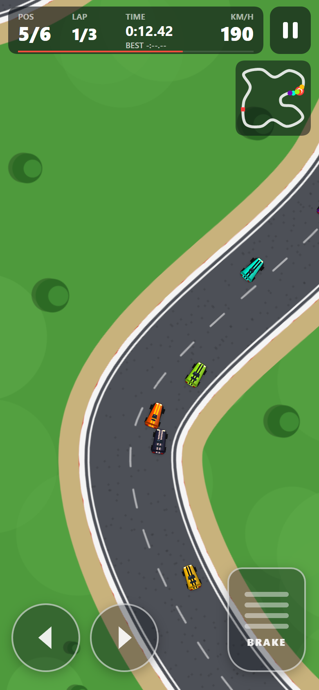
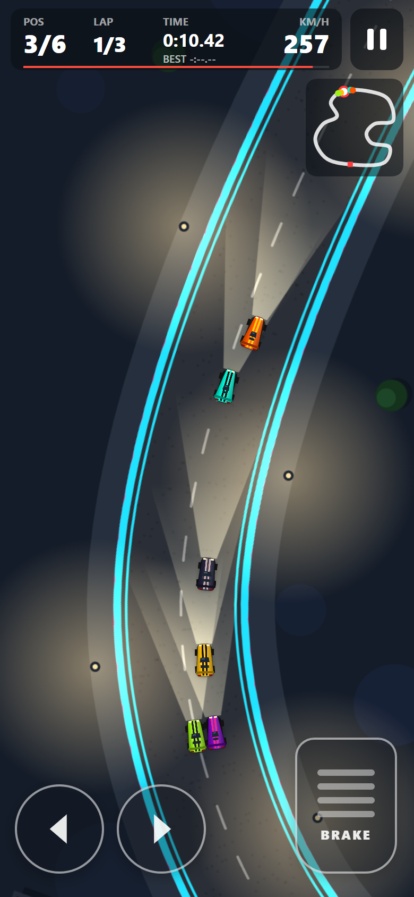
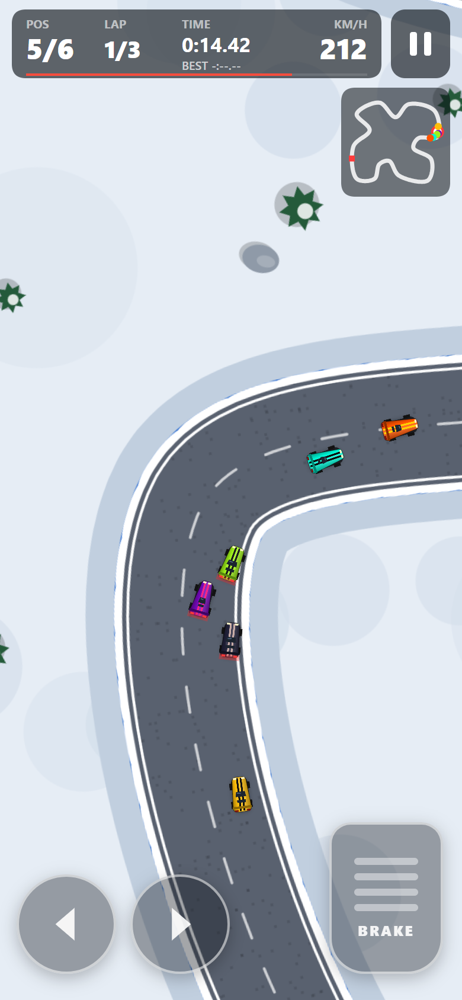
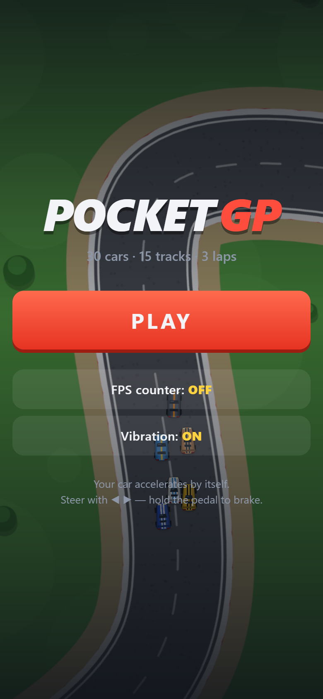
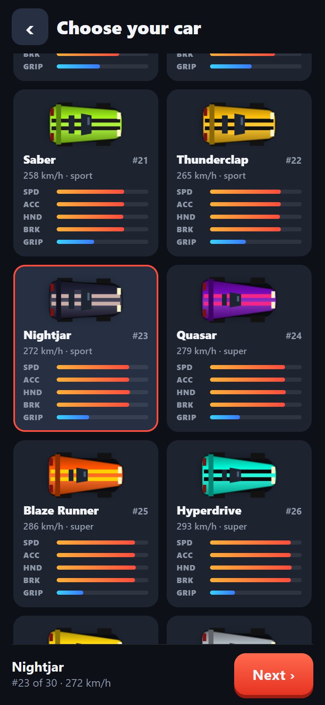
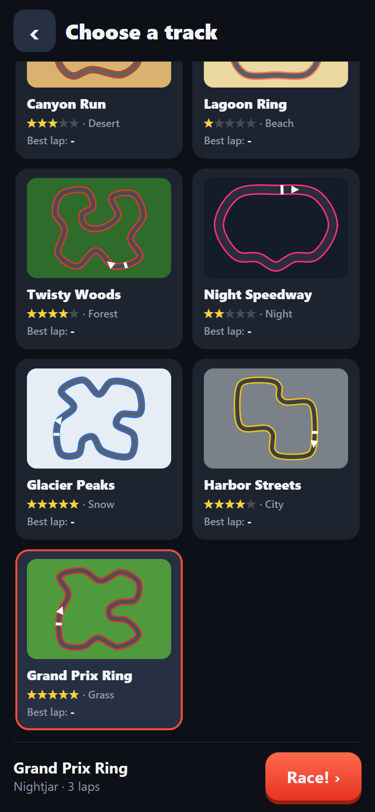
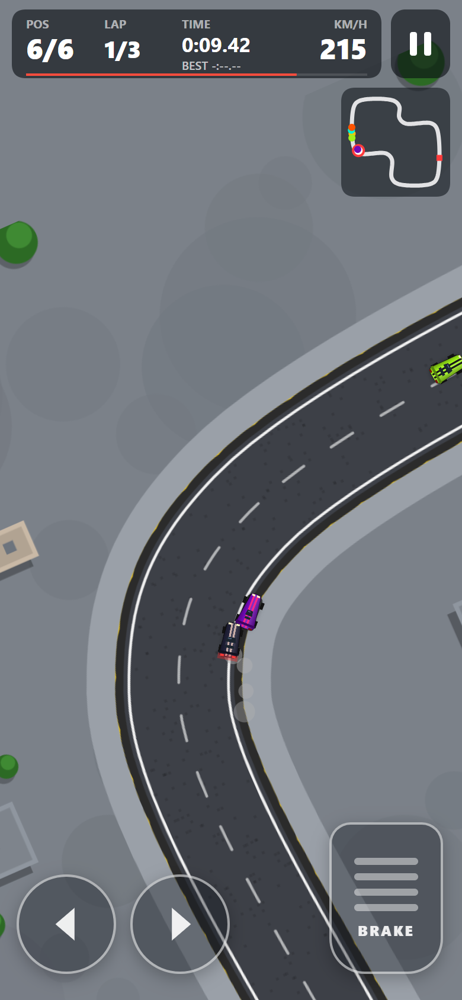
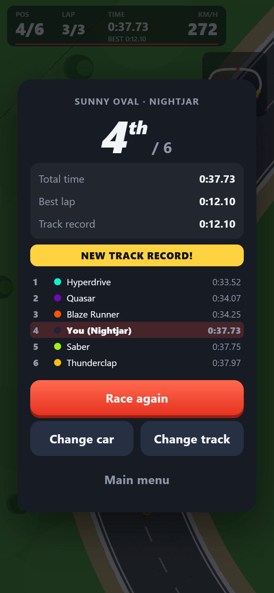

# Pocket GP

A top-down arcade racing game for the browser, built for phones held upright.
It has 30 cars, 15 tracks, and 3-lap races against five AI drivers.

**▶ Play it here: https://davidvelceski1-cloud.github.io/pocket-gp/**

<p align="center">
  
  
  
</p>

## Screenshots

| Main menu | Choose your car | Choose a track |
|:---:|:---:|:---:|
|  |  |  |

| City streets | Race results |
|:---:|:---:|
|  |  |

## How to play

Your car accelerates by itself. You only steer and brake.

| | Phone | Keyboard |
|---|---|---|
| Steer | ◀ ▶ buttons | ← → or A D |
| Brake | Hold the brake pedal | Space, ↓ or S |
| Pause | ⏸ button | P or Esc |

Leaving the road slows you down. Invisible walls at the edge of the run-off stop you from cutting across the infield.

## Features

- **30 cars** across compact, sedan, sport and super classes. Each has its own speed, acceleration, handling, braking and grip.
- **15 tracks** in 7 themes: grass, desert, snow, night, city, beach and forest. Difficulty is rated from 1 to 5 stars.
- **Best lap and track record** for each track, saved in your browser.
- **Mini-map, live position and lap times** on the race screen.
- **Vibration** on bumps and wall hits, and an optional FPS counter.
- Runs at the same game speed on 30, 60 and 120 Hz screens.

## Run it locally

There's nothing to install or build. Open `index.html` in a browser, or serve the folder with any static server:

```sh
npx serve .
```

## Project layout

| File | What it does |
|---|---|
| `js/cars.js` | Car names, colours and stats |
| `js/tracks.js` | Track layouts, themes and checkpoints |
| `js/physics.js` | Car movement, walls and car-to-car collisions |
| `js/ai.js` | AI drivers |
| `js/race.js` | Starting grid, laps, positions |
| `js/input.js` | Touch and keyboard controls |
| `js/render.js` | Camera, track, cars, HUD and mini-map |
| `js/main.js` | Game loop and menus |
